# Iteration 4 — Calendar Read and Export Device Test

**Tester:** 조준우
**Run date:** 2026-11-12 (as shown by the device calendar)
**Visible capture time:** 12:35–12:42 KST
**Source:** `main` at `e1f5cc3`
**APK:** `team2-iter4-live-release-e1f5cc3.apk`, version `0.1.0`
**APK SHA-256:** `3CD17B13F8D872B2BC3B3E8372C2AC16E8D41DFDE912ED35F95AFE249E9C0A41`
**Device / Android version:** Samsung Galaxy S24+ / Android 14  
**Network:** KT 5G (status-bar indicator)

## Scope

Physical-device verification of calendar import/read and one-way export, using the Iteration 4 release APK. This is implementation verification for the assigned calendar tasks; the separate UAT session and its result fields remain for the later UAT run.

## Summary

| Check | Result | Observed behavior |
|---|---|---|
| Read permission denied | Pass | The app reported that calendar data was not applied and offered permission retry / app settings guidance. |
| Read permission granted | Pass | The app showed 2 reflected events and 1 all-day event. |
| App-settings permission recovery | Pass | After permission was denied, calendar access was re-enabled in app settings; returning to the app and retrying the import succeeded. |
| Existing timed event | Pass | The 20:00–21:00 event appeared as an external event, and study sessions ended by 20:00. |
| All-day Free event | Pass | The Free all-day event did not block the full date; study sessions were scheduled on that date. |
| Repeating 20:00–21:00 event | Pass | With 18:00–21:00 weekly availability, the import screen showed 5 recurring occurrences; generated sessions stopped by 20:00 on affected days. |
| Export permission denied | Pass | The app reported no events were added and directed the tester to app calendar permissions. |
| Export to device calendar | Pass | The confirmation showed 16 study sessions in `My calendar`, using Asia/Seoul time; the app reported 16 events added. The device calendar displayed the exported study topics and times. |
| Re-export same plan | Confirmed duplicate behavior | After two export attempts, 2 duplicate calendar events were observed. |

## Procedure and observations

### Calendar read

1. Started a new plan and opened the study-time screen.
2. Tapped **캘린더 일정 불러오기** and denied `READ_CALENDAR` once.
3. Confirmed the app showed the permission-denied guidance, including retry and app-settings actions.
4. Opened app settings from the denied-permission guidance, re-enabled calendar access, returned to the app, and retried the import.
5. Confirmed the screen reported **반영한 일정 2개** and **종일 일정 1개**.
6. Checked the existing timed event scenario. The 20:00–21:00 event was shown as an external event, and study sessions did not overlap it.
7. Checked an all-day event marked Free. The planner scheduled study sessions on that date instead of blocking the whole day.
8. Checked a repeating 20:00–21:00 event against 18:00–21:00 weekly availability. The import summary showed 5 recurring occurrences, and generated study sessions stopped by 20:00 on affected days.

### Calendar export

1. Opened the generated plan, which contained 16 study sessions.
2. Denied calendar export permission once and confirmed the app said no events had been added and showed the settings guidance.
3. Retried with permission granted, selected `My calendar`, and reviewed the confirmation: plan 1, 16 study sessions, Korea time (`Asia/Seoul`).
4. Confirmed the export. The app reported 16 events added.
5. Opened the device calendar and visually checked the exported topics and times on Nov 14 and Nov 15.

Export is a one-way copy. After two export attempts for the same plan, 2 duplicate calendar events were observed.

## Evidence

The calendar chooser screenshot containing account email addresses was intentionally excluded from this evidence set. The remaining screenshots are stored beside this report.

### Test calendar and permission handling

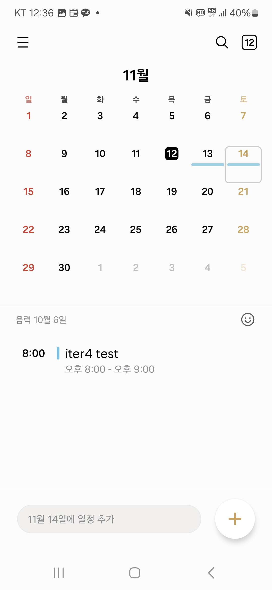
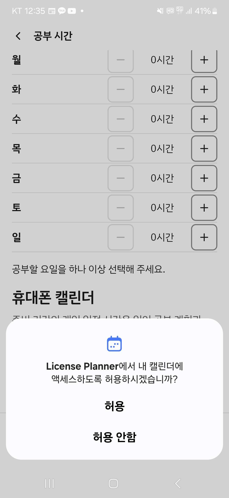
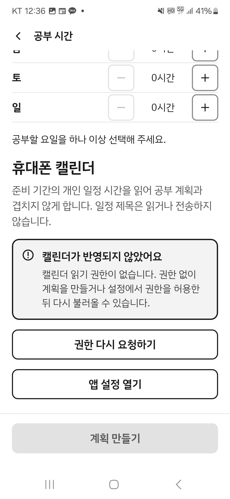
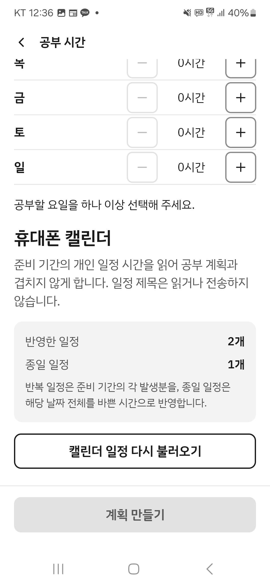
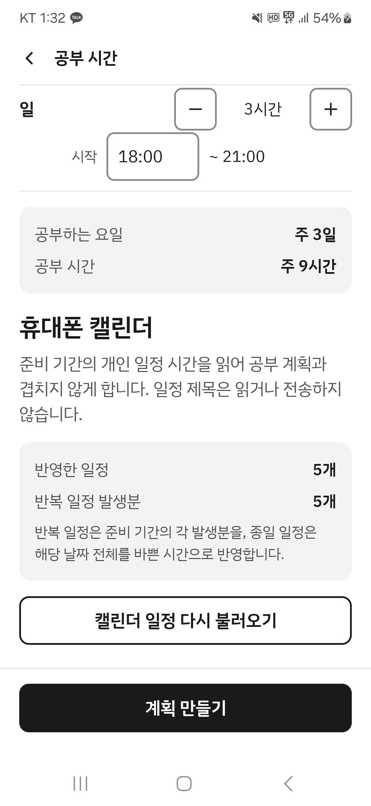

### Calendar scenario outcomes

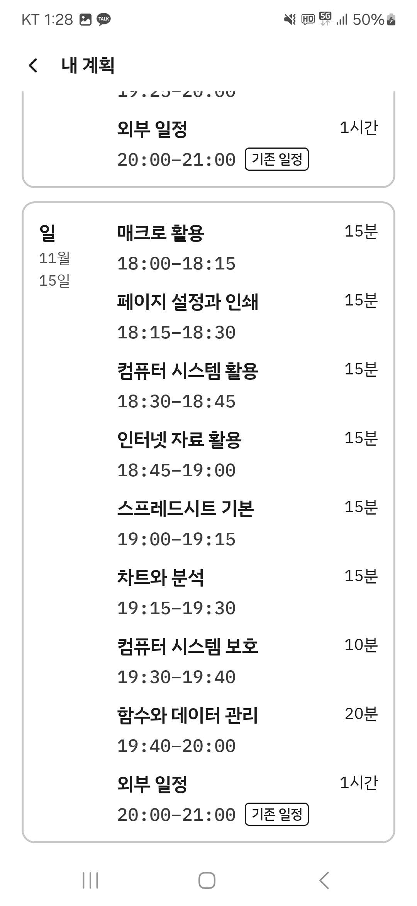
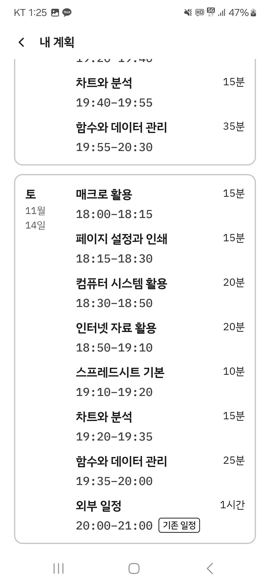
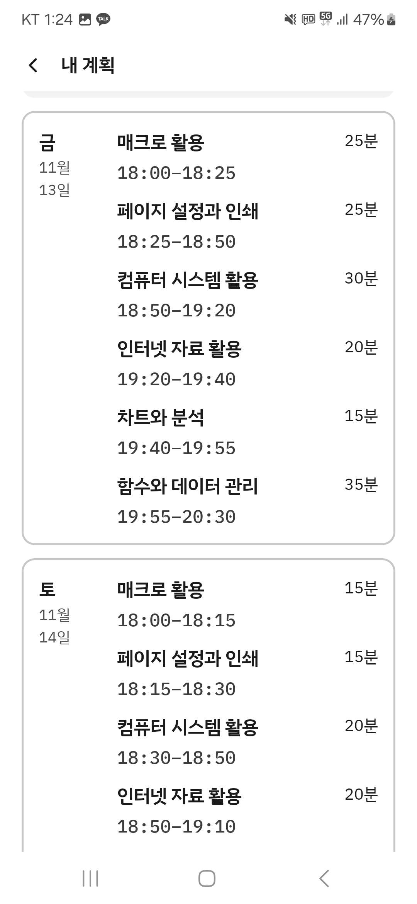
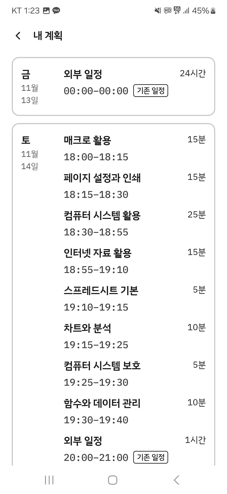
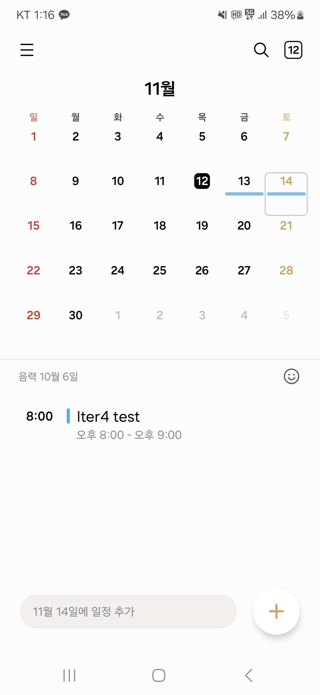

### Plan and export

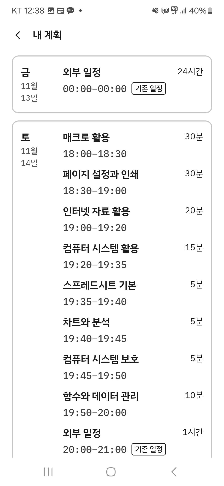
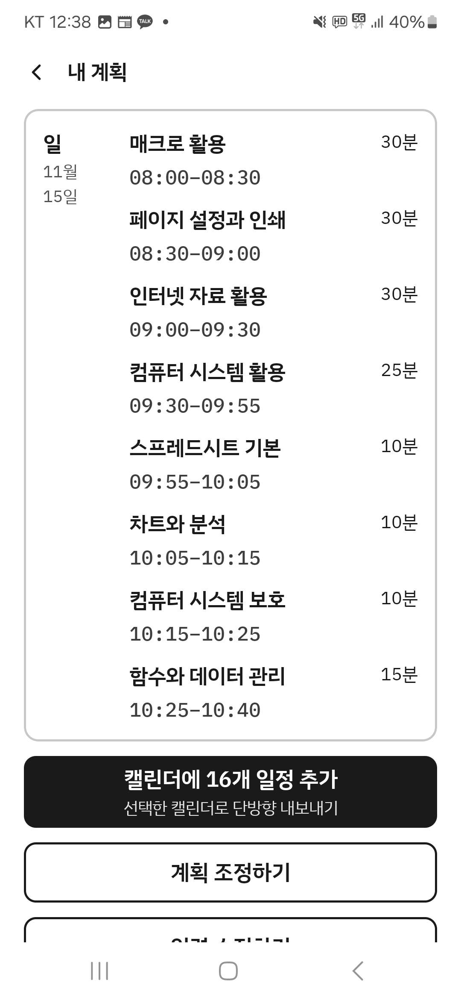
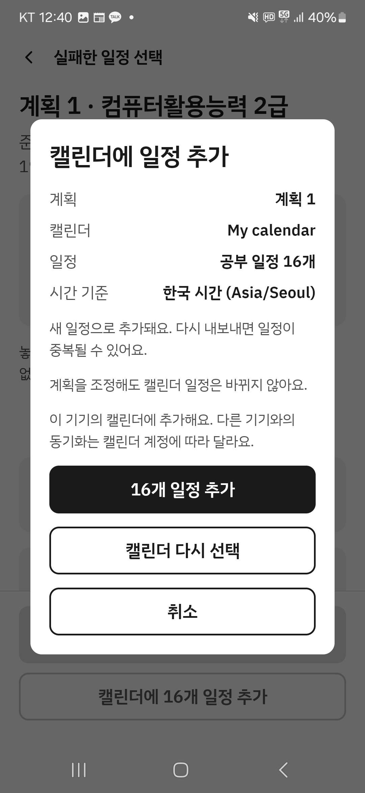
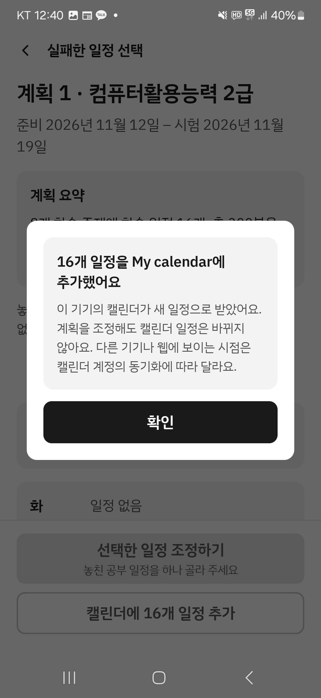

### Device calendar verification and denied export

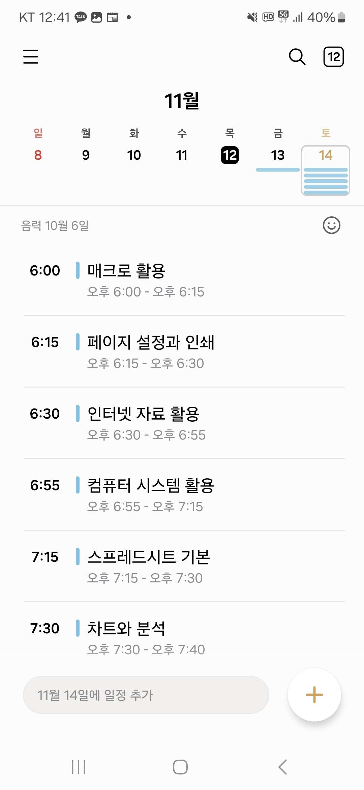
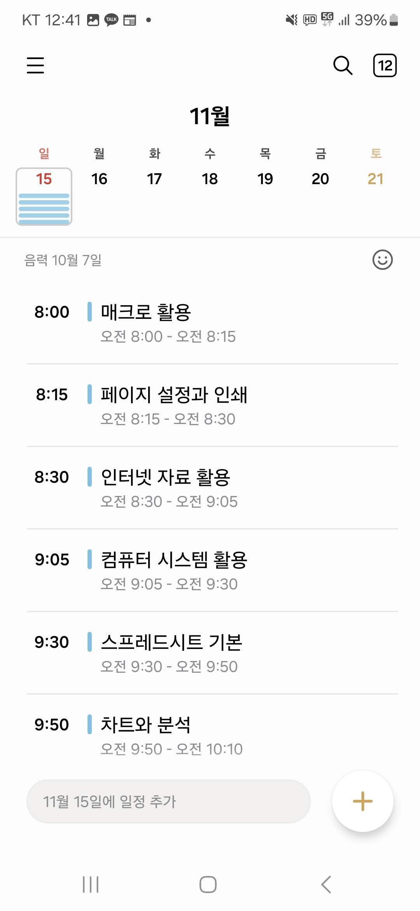
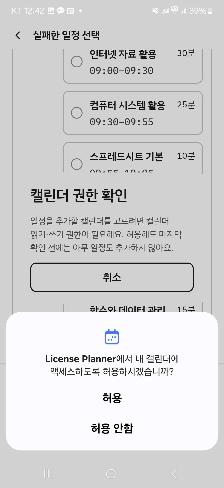
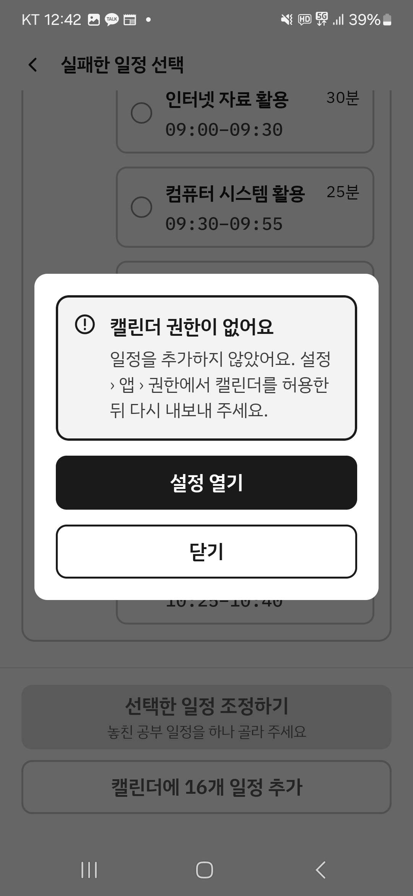

## Limitations

- This run verifies behavior on a Samsung Galaxy S24+ running Android 14; it does not establish compatibility across other devices or Android versions.
- The screenshots show the KT 5G indicator; no independent network diagnostic or API health check was recorded as part of this test.
- Canceled-event filtering was excluded from physical-device verification: sending the Google Calendar cancellation email removed the event from Google Calendar immediately, leaving no stable canceled event for the app to read. The filtering rule is covered by the repository test. Calendar sync to another device was also not tested. Permission recovery, all-day Free handling, recurring-event expansion, and duplicate creation on re-export were verified as described above.
- The screenshot evidence supports the assigned calendar flows; it is not a substitute for the separate UAT execution.
